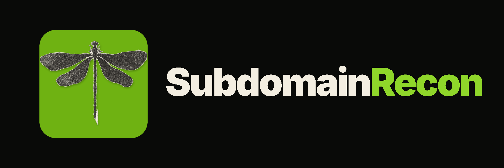
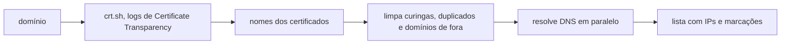

<p align="center"><sub>Subdomain Recon</sub></p>

---

<p align="center">
  
</p>

<p align="center">
  Inventário passivo de subdomínios com Certificate Transparency (crt.sh) e DNS
</p>

<p align="center">
  
  
  <a href="https://github.com/arthurlynow098/subdomain-recon/actions/workflows/testes.yml"></a>
  
</p>

## Sobre o projeto

Uma empresa não protege o que ela nem sabe que existe. É comum ter um `homolog.empresa.com.br` esquecido, rodando uma versão antiga do sistema, ou um painel do Jenkins que alguém publicou para testar e nunca mais tirou do ar. Esse tipo de coisa é o que se chama de **superfície de ataque**, e mapear ela é o primeiro passo tanto de quem defende quanto de um pentest autorizado.

O Subdomain Recon faz esse inventário de forma **passiva**. Ele consulta os logs públicos de Certificate Transparency pelo crt.sh, junta todos os nomes que já apareceram em certificado TLS do domínio, confere quais ainda resolvem para um IP e destaca os nomes que costumam merecer revisão, como `dev`, `homolog`, `admin` e `vpn`.

## Como funciona



## Tecnologias

<p>
  
  
  
</p>

## Executando o código

Só precisa de Python 3.10 ou mais novo.

```bash
git clone https://github.com/arthurlynow098/subdomain-recon.git
cd subdomain-recon

python -m recon example.com
python -m recon minhaempresa.com.br --vivos -o inventario.json
python -m recon minhaempresa.com.br --sem-dns -o nomes.txt
```

O crt.sh é um serviço gratuito e às vezes fica lento. Se der timeout, é só tentar de novo depois de alguns minutos.

Testes

```bash
pip install -r requirements-dev.txt
python -m pytest -q
```

## Exemplo

Resultado real para o `example.com`, domínio reservado para exemplos de documentação.

```text
  7 subdomínio(s) para example.com

  dev.example.com                              não resolve  [dev]
  emudhra-lab.example.com                      não resolve
  example.com                                  104.20.23.154, 172.66.147.243, 2606:4700:10::6814:179a
  m.example.com                                não resolve
  products.example.com                         não resolve
  support.example.com                          não resolve
  www.example.com                              104.20.23.154, 172.66.147.243, 2606:4700:10::6814:179a

  1 nome(s) que costumam merecer revisão (ambiente de teste, painel, CI)
```

Repare que vários nomes tiveram certificado emitido no passado mas não resolvem mais. Num inventário real esses são ótimos candidatos para conferir se o DNS foi limpo direito.

## Estudei por aqui

Segui essas aulas e materiais para entender e aplicar tudo que está aqui.

| Material | O que tirei dele |
|---|---|
| [TryHackMe, Subdomain Enumeration](https://tryhackme.com/room/subdomainenumeration) | Técnicas passivas e ativas e quando usar cada uma |
| [Certificate Transparency](https://certificate.transparency.dev/) | Como os logs funcionam e para que servem |
| [crt.sh](https://crt.sh/) | A interface de busca que o projeto consulta |
| [Documentação do módulo socket](https://docs.python.org/3/library/socket.html) | `getaddrinfo` para resolver IPv4 e IPv6 |

## Licença

Distribuído sob a licença MIT. Veja o arquivo [LICENSE](LICENSE).

<p align="center"><sub>A gravura do banner é a libélula de Wenceslaus Hollar, de 1646, em domínio público no <a href="https://commons.wikimedia.org/wiki/File%3AWenceslas_Hollar_-_Dragonflies_and_a_bumble_bee_%28State_1%29.jpg">Wikimedia Commons</a>.</sub></p>
