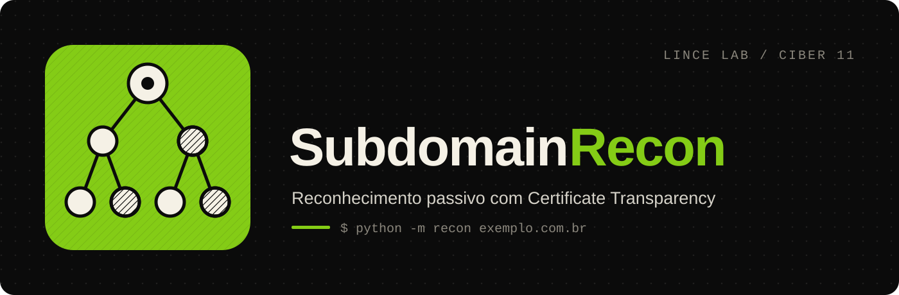
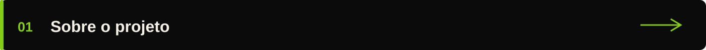
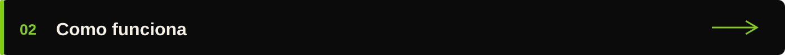
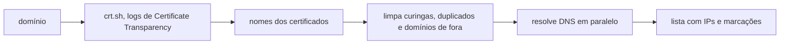
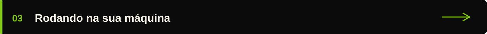
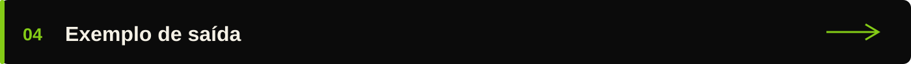

<a id="top"></a>

<p align="center"></p>

<p align="center">


<a href="https://github.com/arthurlynow098/subdomain-recon/actions/workflows/testes.yml"></a>

</p>

<p align="center"><a href="#sobre">Sobre</a> &nbsp;&nbsp; <a href="#como-funciona">Como funciona</a> &nbsp;&nbsp; <a href="#rodando">Rodando</a> &nbsp;&nbsp; <a href="#aprendi">O que aprendi</a> &nbsp;&nbsp; <a href="#estudos">Estudos</a></p>

<a id="sobre"></a>

<p></p>

Uma empresa não protege o que ela nem sabe que existe. É comum ter um `homolog.empresa.com.br` esquecido, rodando uma versão antiga do sistema, ou um painel do Jenkins que alguém publicou para testar e nunca mais tirou do ar. Esse tipo de coisa é o que se chama de **superfície de ataque**, e mapear ela é o primeiro passo tanto de quem defende quanto de um pentest autorizado.

O Subdomain Recon faz esse inventário de forma **passiva**. Ele consulta os logs públicos de Certificate Transparency pelo crt.sh, junta todos os nomes que já apareceram em certificado TLS do domínio, confere quais ainda resolvem para um IP e destaca os nomes que costumam merecer revisão, como `dev`, `homolog`, `admin` e `vpn`.

<a id="como-funciona"></a>

<p></p>



**Por que passivo importa.** O programa não manda nenhum pacote para os servidores do domínio consultado. Ele só lê dados públicos (os logs de CT) e faz consultas DNS normais, iguais às que qualquer navegador faz. Isso torna a ferramenta segura para usar no inventário da sua própria empresa sem disparar alarme nenhum.

Alguns cuidados que tomei

- Certificados curinga (`*.api.exemplo.com.br`) viram o nome base, sem o asterisco
- Nomes de outros domínios que aparecem no mesmo certificado são descartados
- Tudo é normalizado em minúsculo antes de remover duplicados
- O DNS é resolvido com um pool de threads, porque é espera de rede pura
- Os testes injetam funções falsas no lugar do crt.sh e do DNS, então rodam sem internet

<a id="rodando"></a>

<p></p>

Só precisa de Python 3.10 ou mais novo.

```bash
git clone https://github.com/arthurlynow098/subdomain-recon.git
cd subdomain-recon

python -m recon example.com
python -m recon minhaempresa.com.br --vivos -o inventario.json
python -m recon minhaempresa.com.br --sem-dns -o nomes.txt
```

O crt.sh é um serviço gratuito e às vezes fica lento. Se der timeout, é só tentar de novo depois de alguns minutos.

Testes

```bash
pip install -r requirements-dev.txt
python -m pytest -q
```

<p></p>

Resultado real para o `example.com`, domínio reservado para exemplos de documentação.

```text
  7 subdomínio(s) para example.com

  dev.example.com                              não resolve  [dev]
  emudhra-lab.example.com                      não resolve
  example.com                                  104.20.23.154, 172.66.147.243, 2606:4700:10::6814:179a
  m.example.com                                não resolve
  products.example.com                         não resolve
  support.example.com                          não resolve
  www.example.com                              104.20.23.154, 172.66.147.243, 2606:4700:10::6814:179a

  1 nome(s) que costumam merecer revisão (ambiente de teste, painel, CI)
```

Repare que vários nomes tiveram certificado emitido no passado mas não resolvem mais. Num inventário real esses são ótimos candidatos para conferir se o DNS foi limpo direito.

<a id="aprendi"></a>

<p></p>

- O que é Certificate Transparency e por que ele existe (detectar certificado emitido indevidamente)
- A diferença entre reconhecimento passivo e ativo
- Consumir uma API JSON com `urllib` sem biblioteca externa
- Resolver DNS em paralelo e tratar nomes que não existem mais
- Injeção de dependência simples para testar código que depende de rede

Próximos passos

- [ ] Somar outras fontes passivas, como registros históricos de DNS
- [ ] Comparar duas execuções e avisar quando surgir subdomínio novo
- [ ] Checar se algum nome aponta para serviço de nuvem desativado (subdomain takeover)

<a id="estudos"></a>

<p></p>

Segui essas aulas e materiais para entender e aplicar tudo que está aqui.

| Material | O que tirei dele |
|---|---|
| [TryHackMe, Subdomain Enumeration](https://tryhackme.com/room/subdomainenumeration) | Técnicas passivas e ativas e quando usar cada uma |
| [Certificate Transparency](https://certificate.transparency.dev/) | Como os logs funcionam e para que servem |
| [crt.sh](https://crt.sh/) | A interface de busca que o projeto consulta |
| [Documentação do módulo socket](https://docs.python.org/3/library/socket.html) | `getaddrinfo` para resolver IPv4 e IPv6 |

<p align="center"><sub>Parte do <a href="https://github.com/arthurlynow098">Lince Lab</a>, minha coleção de projetos de cibersegurança</sub></p>

<p align="center"><a href="#top">Voltar ao topo</a></p>
